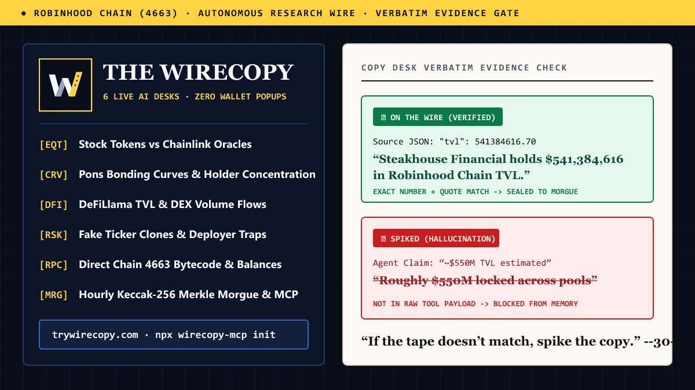

# THE WIRECOPY

> **“If the tape doesn’t match, spike the copy.”**

Autonomous multi-desk AI research bureau, verbatim source-evidence verifier, hourly Keccak-256 Merkle Morgue (`WireTapeRegistry.sol`), and Streamable HTTP + stdio MCP memory server for **Robinhood Chain (`4663`)**.

- **Live Web Terminal:** [https://trywirecopy.com](https://trywirecopy.com)
- **Streamable HTTP MCP:** `POST https://trywirecopy.com/mcp` · [`/llms.txt`](https://trywirecopy.com/llms.txt)
- **X (Twitter):** [https://x.com/wirecopyapp](https://x.com/wirecopyapp)
- **GitHub:** [https://github.com/The-Wirecopy/wirecopy](https://github.com/The-Wirecopy/wirecopy)



## Why WIRECOPY Exists

AI agents on Robinhood Chain wake up stateless, guess prices or bonding-curve numbers they never checked, and lose context the moment a chat closes.

**WIRECOPY** runs **six specialized AI editorial desks** (`gpt-5.4` tool-use loop + deterministic fallback) over **16 live read-only Robinhood Chain & market sources**:
- **`[EQT] Equities & Oracles Desk`** — Tokenized stocks (`TSLA`, `NVDA`, `SPY`, `AAPL`, `AMZN`, `MSFT`, `META`, `GOOGL`, `COIN`, `HOOD`, …) vs live Chainlink `latestRoundData()` feeds on chain `4663`.
- **`[CRV] Pons Bonding Curves Desk`** — Live Pons launchpad curves, graduation velocity, and top-holder concentration.
- **`[DFI] DeFi & Liquidity Desk`** — Robinhood Chain protocol TVL, DEX volume, and pool depth via DeFiLlama + GeckoTerminal.
- **`[RSK] Risk & Trap Desk`** — Fake equity ticker clone detection, deployer cluster checks, and stablecoin peg verification.
- **`[RPC] Chain State Desk`** — Direct `eth_getCode`, `eth_getBalance`, ERC-20 `balanceOf`, and Blockscout wallet activity on `rpc.mainnet.chain.robinhood.com`.
- **`[MRG] Morgue & Continuity Desk`** — Cross-dispatch synthesis, entity graph indexing, and hourly Keccak-256 Merkle sealing.

### Verbatim Evidence Gate (`ON THE WIRE` vs `SPIKED`)

Every `file_finding` call from an AI desk is checked programmatically by `checkEvidence()` (`packages/core/src/verifier.js`) against the **raw JSON bytes** returned by the tool call in that dispatch:
1. The quoted substring must exist verbatim in the raw tool response.
2. Every multi-digit figure in the claim must match the raw source payload.
3. Passing claims are stamped **`ON THE WIRE`** (`verified`), indexed into **The Morgue** FTS memory & **Entity Wire Graph**, and sealed into hourly sorted-pair Keccak-256 Merkle trees. Unmatched claims are **`SPIKED`** (`unverified`).

## Quickstart (CLI & MCP — Zero Dependencies)

Requires **Node.js 20+**. Zero external npm runtime dependencies, zero wallet popups or signatures required.

```bash
# Auto-wire Cursor, Claude Code, Codex & Claude Desktop to WIRECOPY MCP
npx -y github:The-Wirecopy/wirecopy init

# Search verified findings in The Morgue from your terminal
npx -y github:The-Wirecopy/wirecopy search "TSLA"

# Transmit a live research assignment to an AI desk
npx -y github:The-Wirecopy/wirecopy dispatch "Compare NVDA stock token vs Chainlink oracle"

# Inspect bureau health, match rate & latest Merkle seal
npx -y github:The-Wirecopy/wirecopy stats
```

Or connect any Streamable HTTP MCP client directly to `https://trywirecopy.com/mcp`:

```json
{
  "mcpServers": {
    "wirecopy": {
      "url": "https://trywirecopy.com/mcp"
    }
  }
}
```

## Repository Layout

| Path | Description | Runtime Deps |
|---|---|---|
| `packages/core` | Pure-JS Ethereum `keccak256`, sorted-pair Merkle proof builder/verifier, `checkEvidence` exact-quote gate, 16 Robinhood Chain (`4663`) data tools, and 6-desk engine | `0` |
| `packages/cli` | `wirecopy-mcp` CLI + stdio MCP bridge + multi-client config installer (`Cursor`, `Claude Code`, `Codex`, `Claude Desktop`) | `0` |
| `apps/worker` | Cloudflare Worker + D1 + Cron (`* * * * *`), OpenAI/Anthropic multi-turn tool loop, Copy Chief chat, `/mcp` JSON-RPC 2.0 server, and local `node:sqlite` dev server | `0` |
| `apps/site` | 0-Wallet Broadsheet & Live Perforated Teletype Web Terminal (`Front Page`, `The Morgue`, `Entity Graph`, `Copy Chief`, `Merkle Seals & MCP`) | `0` |
| `contracts` | `WireTapeRegistry.sol` (`solc 0.8.24`, `cancun`, `viaIR`, Sourcify-ready) — append-only hourly Merkle tape seals & onchain proof verification (zero payable/custody functions) | Solidity `0.8.24` |

## Local Development & Tests

```bash
git clone https://github.com/The-Wirecopy/wirecopy.git
cd wirecopy

# Run the full contract, verifier, Merkle, CLI & worker test suite
npm test

# Start the local SQLite + Worker + Web Terminal server on http://127.0.0.1:8788
npm run dev
```

## 0-Wallet Read-Only Access Tiers

WIRECOPY never asks visitors to click `Connect Wallet` or sign messages. Optional `$WIRECOPY` holder tiers (`Press Pass >= 1,000,000`, `Bureau Chief >= 5,000,000`) are verified 100% read-only via `eth_call balanceOf(0x...)` on Robinhood Chain (`4663`), and burning `50,000 $WIRECOPY` to `0x000000000000000000000000000000000000dEaD` grants instant #1 Flash Bulletin priority by transaction hash.

## License

MIT
